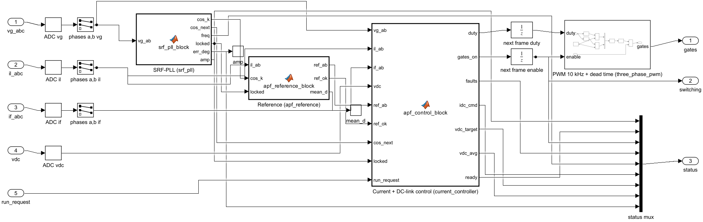
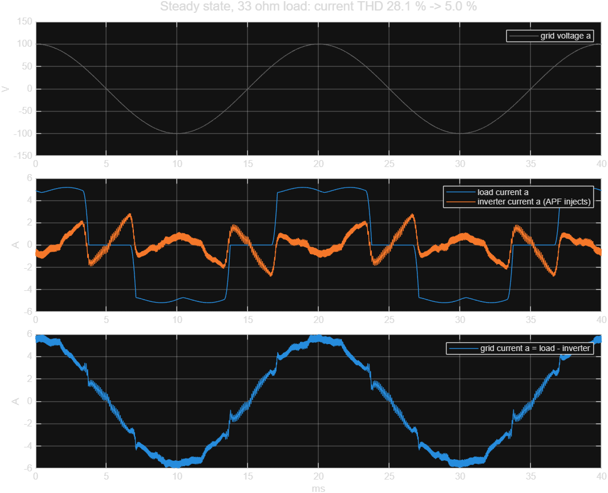
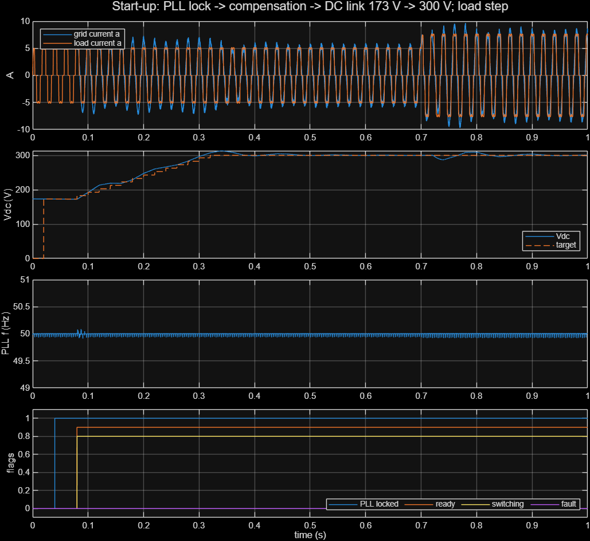
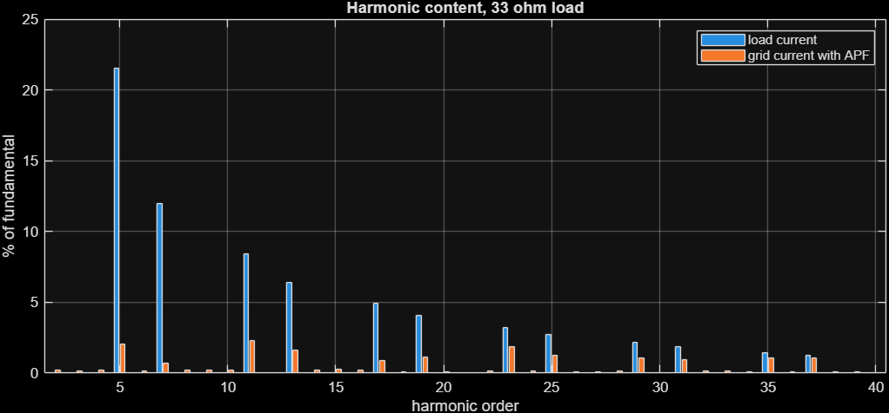
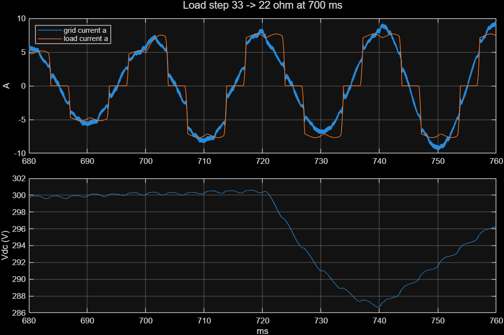

# APF Simulink model

Simulink model of a three-phase shunt active power filter (graduation project).
The controller follows the FPGA design in [Heke03/APF-FPGA](https://github.com/Heke03/APF-FPGA)
block for block, in floating point. The power stage uses real switching devices.

Requires MATLAB R2025a with Simscape Electrical (Specialized Power Systems).


## Model

Power stage (same values as `sim/tb_apf_system.sv` in APF-FPGA):
- grid source
- diode-bridge load with the 0.7 s load step
- IGBT inverter, 3 mH filter, 1000 uF DC link and contactor

The controller subsystem `FPGA controller (apf_core)` maps to the RTL like this:

| Simulink block | RTL (APF-FPGA) |
|---|---|
| ADC zero-order holds (phases a, b only, 10 kHz) | measurement scaling in `apf_core.sv` |
| `SRF-PLL (srf_pll)` | `srf_pll.sv` |
| `Reference (apf_reference)` | `apf_reference.sv` |
| `Current + DC-link control (current_controller)` | `current_controller.sv` plus protection/sequencing from `apf_core.sv` |
| unit delays + `PWM 10 kHz + dead time` | one-frame duty latency + `three_phase_pwm.sv` |



## Results

| | Load current THD | Grid current THD with APF | Grid current vs voltage |
|---|---:|---:|---:|
| 33 ohm load | 28.1 % | **5.0 %** (RTL sim 4.6 %) | -0.5 deg |
| 22 ohm load | 27.5 % | **3.6 %** (RTL sim 3.5 %) | -0.4 deg |

PLL locks at 40 ms and switching starts at 80 ms, the same as the RTL simulation.
Vdc ramps 173 -> 300 V by about 0.33 s. There are no faults.

Differences from the RTL testbench:
- The load has a 0.5 mH AC line reactor. It gives real diode commutation, where the testbench uses a 0.2 ms lag.
- Measurements are ideal (no 12-bit quantization or noise).






The power-stage values are assumptions until the real ones are known.

## Files

- `apf_system.slx`: the model.
- `apf_params.m`: every parameter. The model loads it automatically.
- `blocks/*.m`: code of the three MATLAB Function blocks.
- `build_apf_model.m`: rebuilds the `.slx` from the files above. Run it after editing `blocks/*.m`.
- `run_apf_simulation.m`: 1 s run (about 25 s) that prints THD and writes `results/fig1..4*.png`.
  Copies of the figures are in `docs/figures/`.
- `analyze_apf_results.m`: THD, phase angle and figures (used by `run_apf_simulation`).

## Run

```matlab
run_apf_simulation              % or open apf_system.slx and press Run
```
